# Freelancer-invoice

Application de gestion commerciale pour freelances et PME, pipeline commercial, facturation, suivi de projets, dépenses, rentabilité et reporting comptable.

Développé par **ISSU DEV**.

---

## Captures d'écran

### Configuration initiale
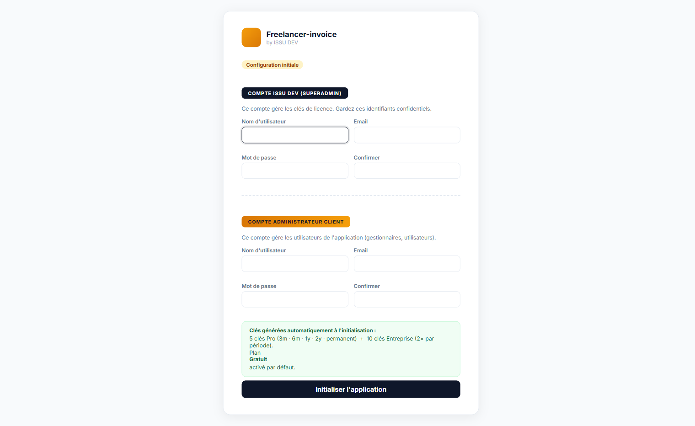

### Connexion


### Tableau de bord
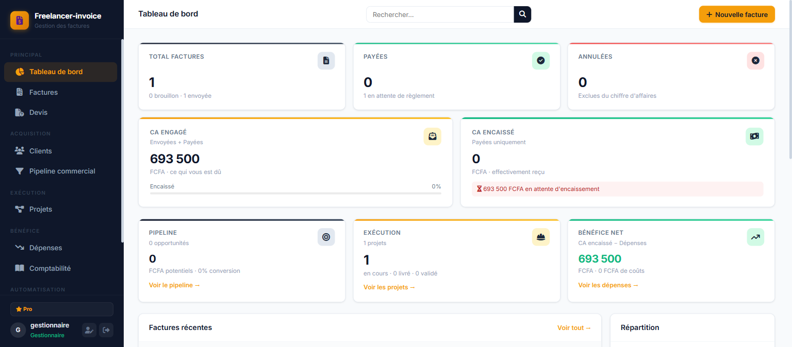

### Nouvelle facture
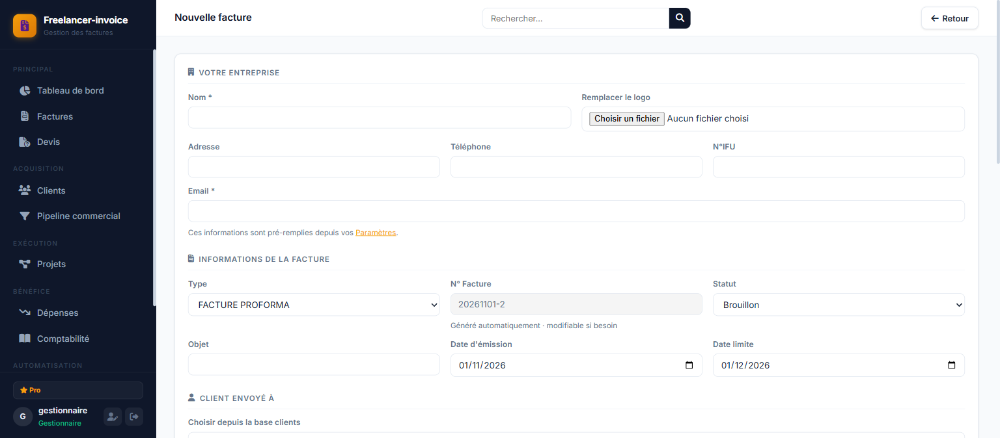

### Édition facture : statut Envoyée


### Liste des factures
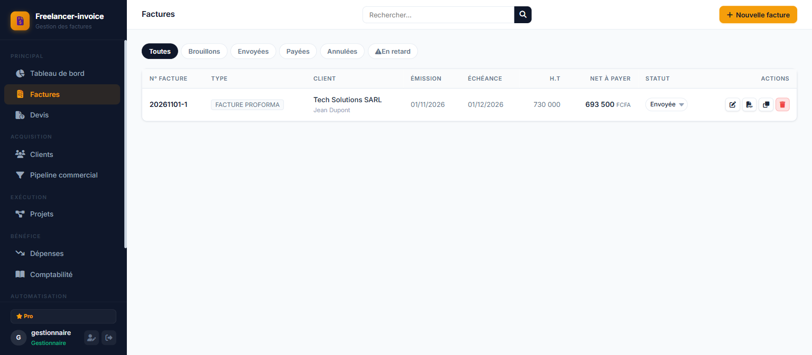

### Devis
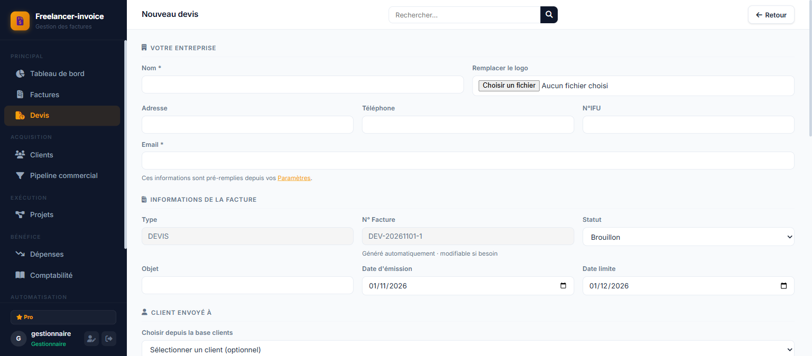

### Pipeline commercial
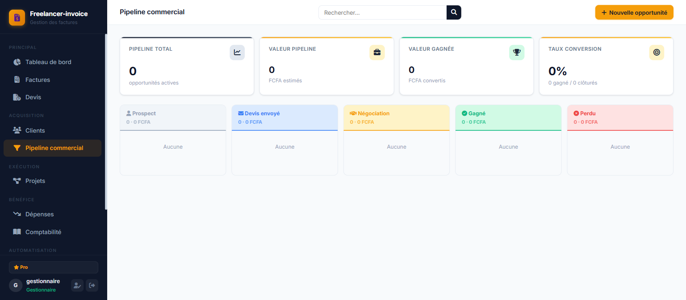

### Clients
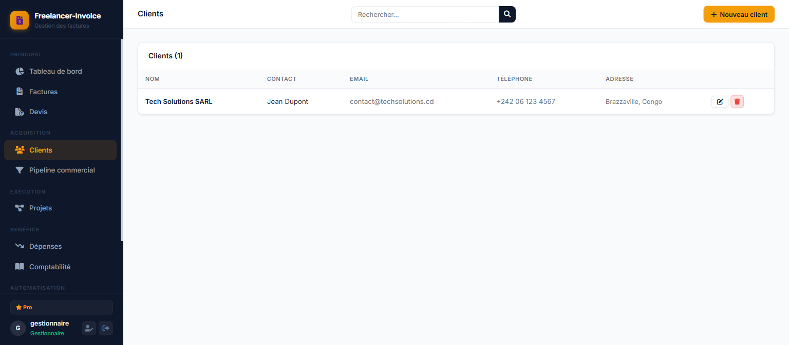

### Projets (auto-créé à l'envoi)
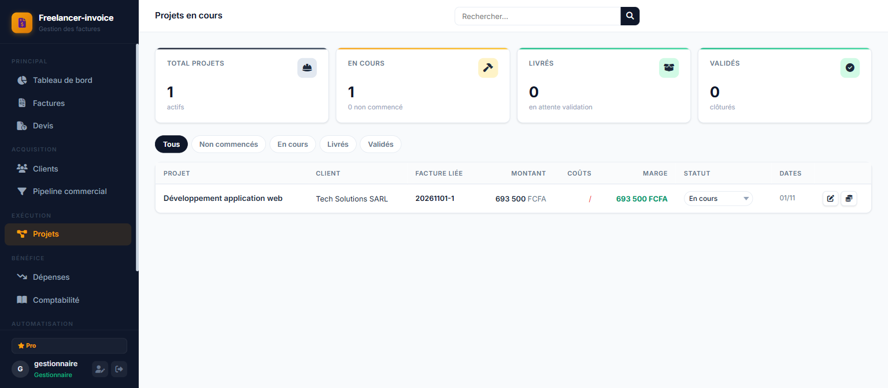

### Dépenses
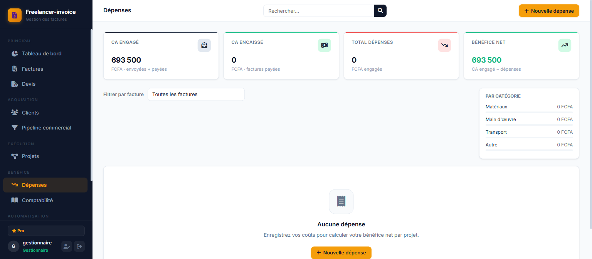

### Saisie d'une dépense
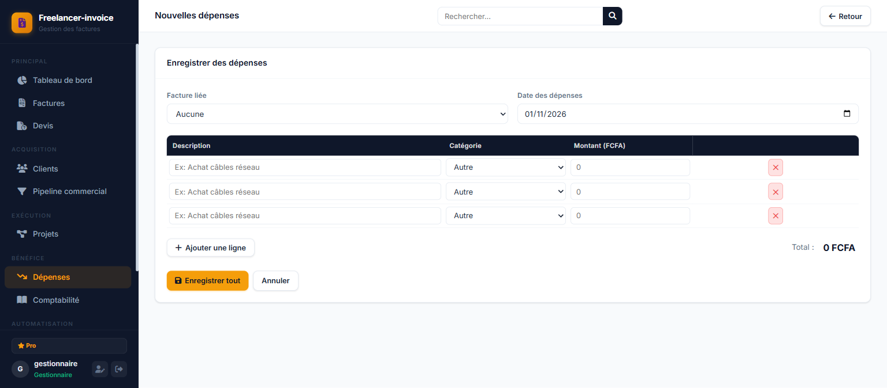

### Comptabilité
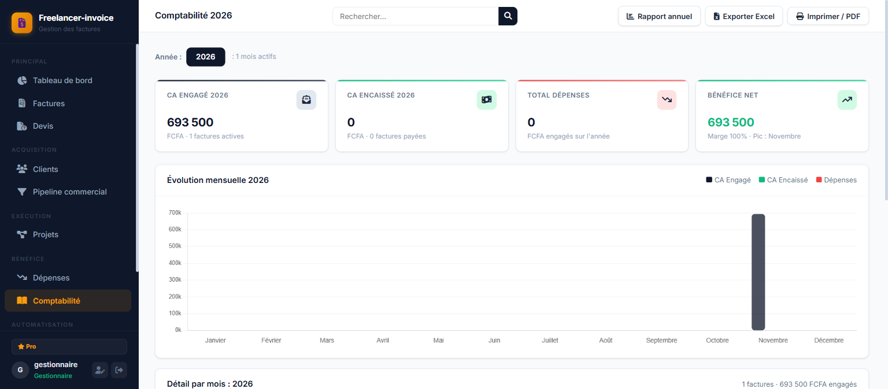

### Facture : bouton PDF
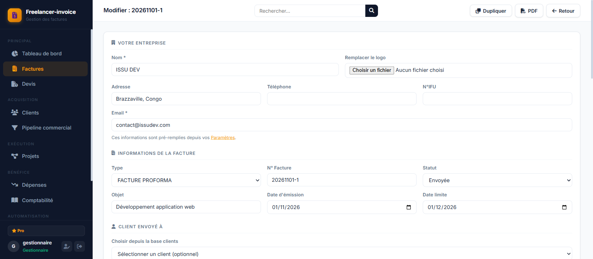

### Administration : Utilisateurs
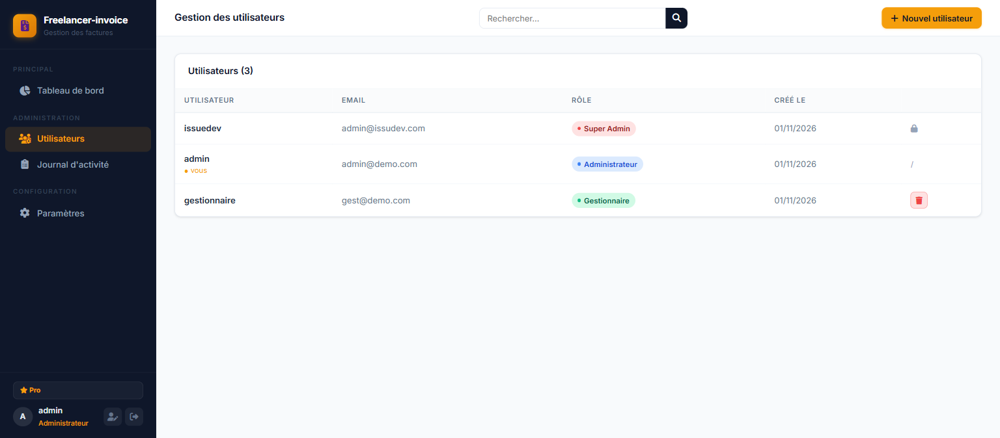

### Administration : Journal d'activité
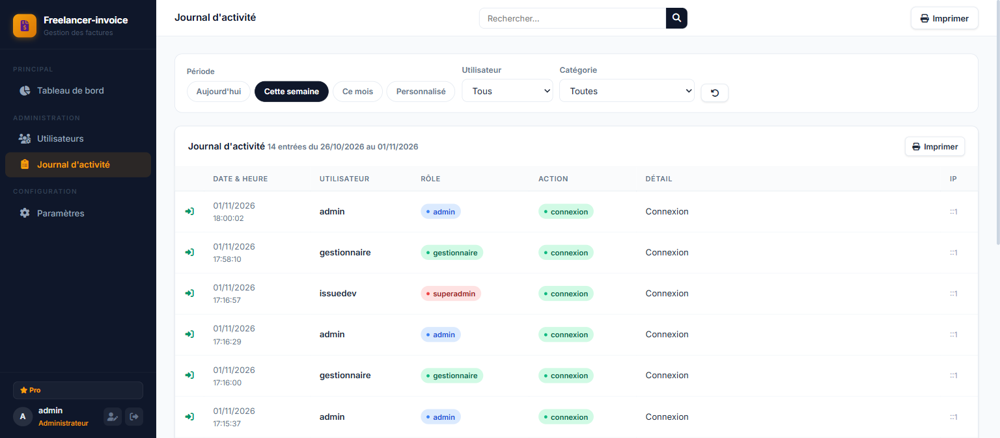

### Paramètres entreprise
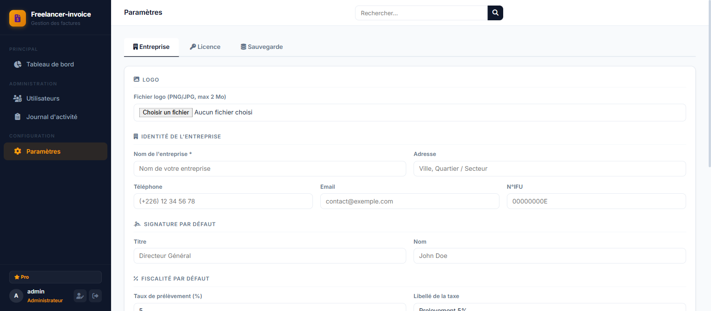

### Paramètres : Licence
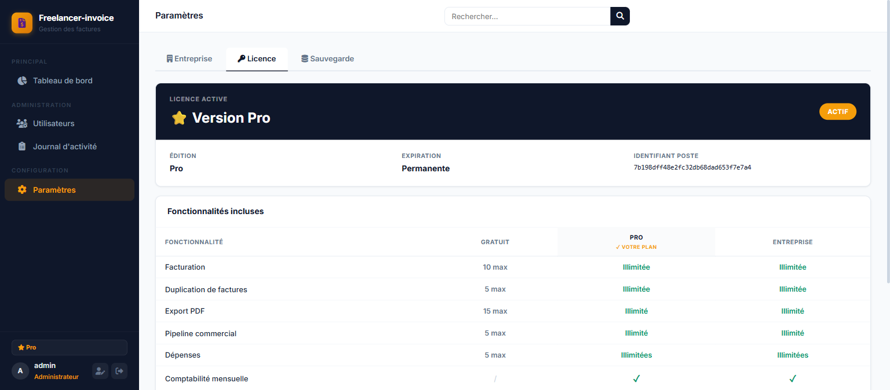

### Superadmin : Gestion des licences
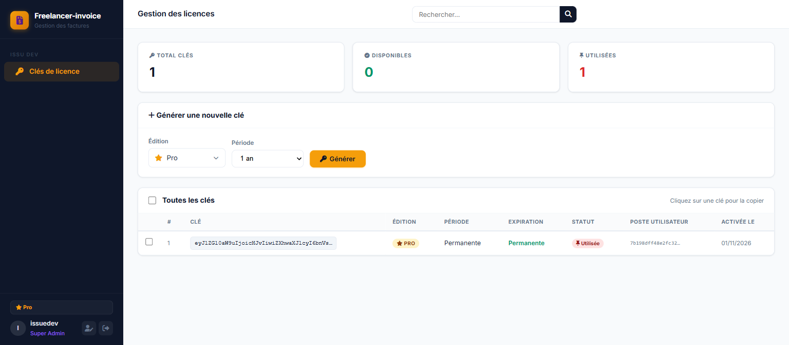

### Activation d'une licence
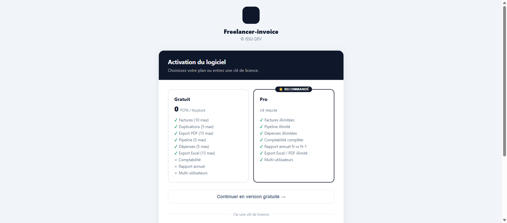

---

## Fonctionnalités

| Module | Description |
|--------|-------------|
| **Pipeline** | Suivi opportunités en 5 étapes, conversion en facture en un clic |
| **Facturation** | Factures Proforma, Devis, Avoirs, export PDF, duplication |
| **Projets** | Création automatique à l'envoi d'une facture, suivi d'avancement |
| **Dépenses** | Saisie multi-lignes par projet, calcul marge nette |
| **Comptabilité** | Vue mensuelle + rapport annuel N vs N-1, export CSV |
| **Clients** | Carnet d'adresses lié aux factures et opportunités |
| **Licences** | Système de clés Pro / Entreprise avec activation par machine |
| **Journal** | Traçabilité complète des actions utilisateurs (admin uniquement) |

---

## Prérequis

- PHP 8.1+ avec extensions : `pdo_sqlite`, `fileinfo`, `mbstring`
- Composer
- Aucune base de données à installer, SQLite auto-généré au premier démarrage

---

## Démarrage rapide

```bat
# 1. Installer les dépendances
composer install

# 2. Démarrer le serveur
php -S localhost:8080 -t public

# Sur Windows : double-cliquer sur start.bat
```

3. Ouvrir **http://localhost:8080/setup.php** — créer le compte administrateur  
4. Se connecter sur **http://localhost:8080/login.php**  
5. Administration → Utilisateurs pour créer les comptes métier (gestionnaire / utilisateur)

> La base `storage/invoices.sqlite` est créée automatiquement — aucune configuration supplémentaire.

---

## Rôles

| Rôle | Accès |
|------|-------|
| **Super Admin** | Gestion des licences uniquement (compte ISSU DEV) |
| **Administrateur** | Gestion des utilisateurs + consultation du journal d'activité |
| **Gestionnaire** | Accès complet : création, modification, suppression sur tout le métier |
| **Utilisateur** | Lecture seule, consultation sans modification |

---

## Configuration entreprise

Paramètres → renseigner le nom, l'adresse, le logo, la TVA et le pied de page. Ces informations pré-remplissent automatiquement chaque nouvelle facture. Cette section est réservée aux gestionnaires.

### Licence

Sans clé : plan gratuit avec limites (10 factures, 5 dépenses, 15 exports PDF…).  
Avec clé **Pro** ou **Entreprise** : fonctionnalités illimitées.

Les clés sont générées par le Super Admin depuis l'interface, ou en ligne de commande :

```bat
php tools/keygen.php pro 1y
php tools/keygen.php enterprise permanent <machine_id>
```

### Sauvegarde

Paramètres → Sauvegarde : export et restauration de la base SQLite en un clic (gestionnaire uniquement).

---

## Structure du projet

```
public/          Points d'entrée PHP
  invoice/       Facturation
  devis/         Devis
  avoir/         Avoirs
  pipeline/      Pipeline commercial
  project/       Projets
  expense/       Dépenses
  accounting/    Comptabilité
  client/        Clients
  admin/         Administration (utilisateurs, journal)
  superadmin/    Gestion licences (ISSU DEV)
src/
  Auth/          Authentification et guards de rôle
  Database/      Repositories + migrations SQLite automatiques
  Services/      PDF (Dompdf), licences, logs d'activité
templates/       Layout partagé (sidebar, topbar)
storage/         Base SQLite (non versionnée)
config/          Clé secrète licence (non versionnée)
tools/           Scripts CLI (keygen)
```

---

## Règles métier

- Les **brouillons** n'entrent dans aucun calcul de CA ni de bénéfice.
- Les **dépenses** ne peuvent être saisies que sur des factures envoyées ou payées.
- La **valeur gagnée** dans le pipeline utilise le montant réel de la facture liée, pas l'estimation initiale.
- Un **projet** est créé automatiquement quand une facture passe au statut "Envoyée".
- Le **PDF** exige des `<table>` HTML, Dompdf ne supporte pas flexbox.

---

## Documentation

- [`docs/guide-utilisateur.md`](docs/guide-utilisateur.md) : guide complet pour les utilisateurs de l'application
- [`docs/guide-installation.md`](docs/guide-installation.md) : procédure de déploiement chez un client

---

© ISSU DEV, Tous droits réservés.
